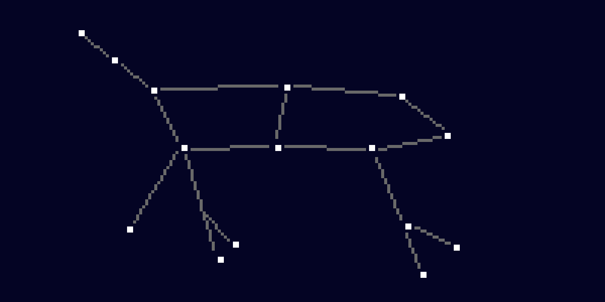
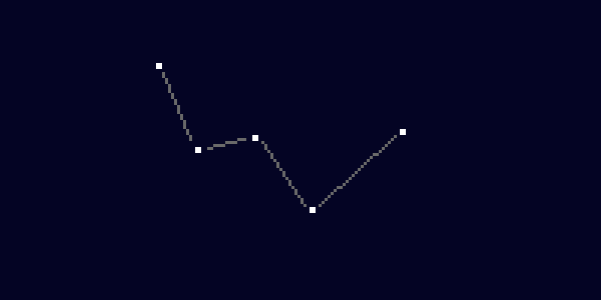
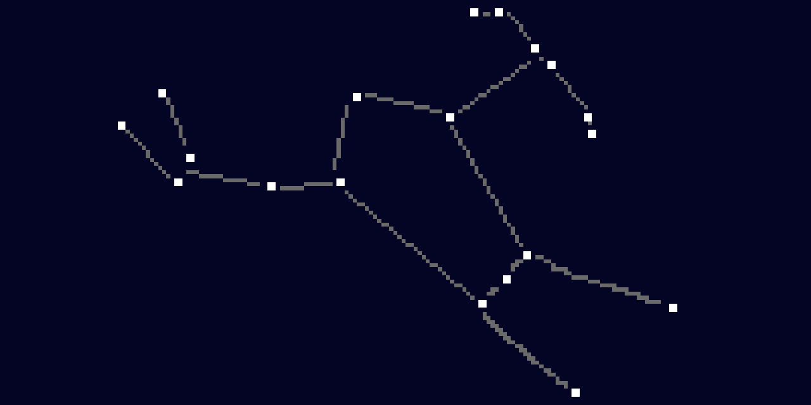

# Web of Stars!

## This is a site that shows webs of stars or constellations!
I thought it was interesting to think of constellations as webs of stars created by a constellation, so I made a 
website based on it!

## Currently it includes 3 Constellations
The Orion, The Great Bear (Ursa major) and Cassiopia (The Queen)

## Notes
No AI for the code, all images created by me using piskelapp.com